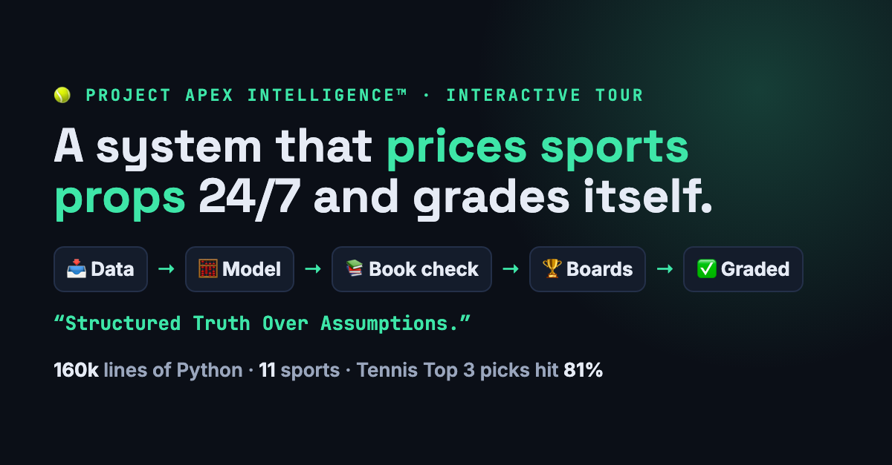

<p align="center"><a href="https://demetriusreynolds251-maker.github.io/apex/"></a></p>
<p align="center"><a href="https://demetriusreynolds251-maker.github.io/apex/"><b>▶ Take the interactive tour</b></a></p>

# apex-tennis

The live core of Apex for tennis. Every few minutes it pulls the current tennis prop lines, prices each one with a match model and sportsbook totals, ranks them into boards ("Top 3", "Elite 6", "Best Goblin / Standard / Demon"), posts changes to Discord, and later grades every pick against real results so the numbers stay honest.

> **Note:** Designed and directed by Demetrius Reynolds and built with AI coding assistants. I understand the code and architecture but am not a professional software engineer.

## The Apex system

Apex is a personal hobby project that prices player props (PrizePicks / ParlayPlay style "more or less" lines) by comparing a model probability with sportsbook prices, then posts ranked boards and results to private Discord channels. It is split into these repos:

| Repo | Role |
|---|---|
| `apex-tennis` | Live tennis system: scheduler, model, boards, grading, Discord bot, dashboard |
| `apex-tennis-warehouse` | Collector that keeps the tennis match/stats database up to date |
| `apex-tennis-research` | Backtests, audits and write-ups behind the tennis rules |
| `apex-multisport` | Same idea for other sports (NBA, NFL, NHL, soccer and more), separate from tennis |

Nothing here places bets. It is research and alerting only.

## What is in here

| Part | Main files | What it does |
|---|---|---|
| Scheduler | `openclaw_core.py` | Long-running loop: fetches lines, runs the engine, publishes boards, runs timed jobs (5 PM run, settles, reports) |
| Model / engine | `apex_prop_engine.py`, `apex_prop_model_v1.py`, `apex_prop_sim_v1.py`, `apex_v2_*.py` | Turns player stats, surface and match odds into a win probability for each prop |
| Prices | `apex_price_feed.py`, `apex_bet365_totals.py`, `apex_pinnacle.py`, `apex_book_lines.py` | Reads sportsbook prices and totals used as a check on the model |
| Boards and rules | `apex_edge_tracker.py`, `apex_card_signals.py`, `rule_registry.py` | Ranking, holds, backups and the order check on every publish |
| Grading | `apex_settle_sa365.py`, `apex_daily_settlement_health.py` | Settles picks and slips from final scores, voids retirements / walkovers |
| Alerts | `apex_alerts.py`, `apex_alert_cards.py`, `apex_ops_watchdog.py` | Change-only Discord alerts, heartbeat and watchdog |
| Discord bot | `discord_bot.py` | Slash and text commands (`/allprops`, `/h2h`, `/pnl`, …) |
| Dashboard | `openclaw_mission_control.py` | Small local web dashboard (port 8788) with basic auth |
| ParlayPlay | `ApexParlayPlay/` | Same pricing applied to ParlayPlay lines, own schedule |
| Ops | `tools/`, `deploy/jobs/`, `deploy/launchd/` | Log rotation, safe restart, replay tools, and the macOS launchd jobs that run everything |

About 190 files and 90,000 lines of Python. The code is a flat set of modules that import each other, so the parts above are not separate packages.

## Tech

Python 3.9+, SQLite, `requests`, `discord.py`, numpy / pandas / scikit-learn / xgboost for the models, Playwright for one page that has no API, macOS launchd for scheduling. Data comes from SportsAPI365, sportsbook feeds and public tennis match history (Jeff Sackmann / TennisMyLife).

## Running it (placeholders)

```bash
python3 -m venv .venv && source .venv/bin/activate
pip install -r requirements.txt
cp .env.example .env            # fill in your own values
set -a; source .env; set +a
python3 openclaw_core.py        # scheduler
python3 discord_bot.py          # bot, in a second terminal
python3 openclaw_mission_control.py 8788   # dashboard
```

You also need the data files the system builds over time (`data/props_db.sqlite`, the tennis warehouse from `apex-tennis-warehouse`, logs). They are not in this repo, so a fresh checkout starts empty. The launchd plists in `deploy/launchd/` show how it runs on a Mac; paths in them use `/path/to/home` as a placeholder.

## Not included

Secrets (now read from env vars or ignored key files), all databases, logs, raw odds history, Discord channel IDs and webhook URLs.

## License

[Apex Share-Back License 1.1](LICENSE): free to use, study and build on for non-commercial purposes. If you use it, you agree to share your findings and improvements back publicly and for free and credit "Based on Apex by Demetrius Reynolds". Selling it or using it in a paid product needs a written commercial license: [ask on LinkedIn](https://www.linkedin.com/in/demetrius-reynolds/). See the [terms on the site](https://demetriusreynolds251-maker.github.io/apex/#share).
